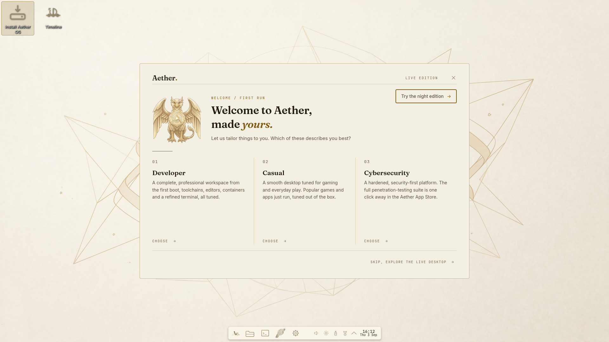
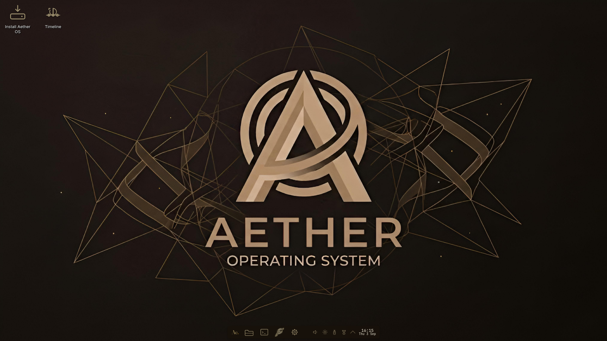
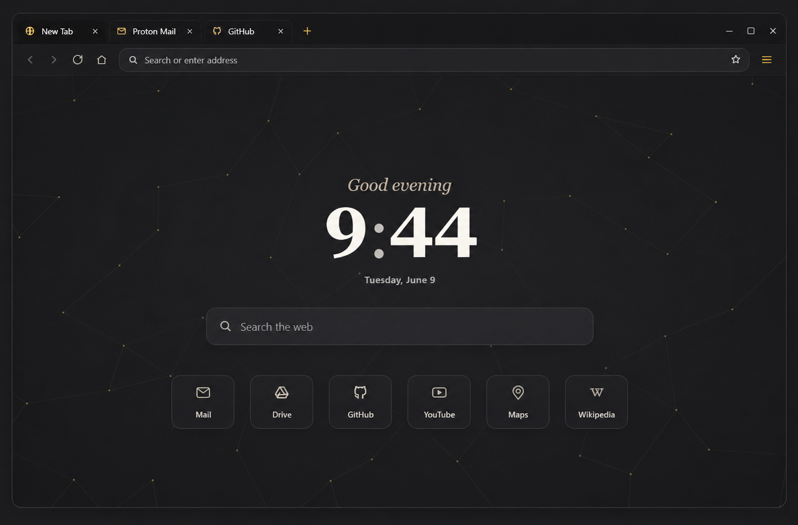

<h1 align="center">Aether OS</h1>

<b>A Linux distribution for people who have always been scared to try Linux.</b> 
Arch Linux + KDE Plasma underneath, a calm editorial desktop on top, and setup that does the hard parts for you.

<a href="https://www.runaether.tn"><b>Download at runaether.tn</b></a> · ISO, about 4.8 GB

---

## What it does

| | |
|---|---|
| **Welcome, made yours** | The first-boot wizard asks who you are (**Developer**, **Casual** or **Cybersecurity**) and whether you want the day or night edition, then sets up the desktop for that. Tapping light or dark flips the whole OS live, before you've even finished the wizard. |
| **Game Ready** | On first run it audits the graphics stack (GPU acceleration, Vulkan, Direct3D-to-Vulkan translation, runtime libraries) plus Steam, Bottles and Heroic, and installs whatever is missing in one click. |
| **`please`** | Package and system jobs without memorising `pacman` flags: `please install …`, `please update`. It always shows the real command and asks before changing anything. |
| **`please`, the smart half** | Anything that isn't a fixed verb goes to an AI agent that answers or proposes commands. The model is treated as **untrusted**: nothing runs without an explicit yes (default no), and a separate danger classifier, not the model, blocks destructive commands. |
| **Timeline** | A Btrfs snapshot manager. If an update or a mistake breaks something, roll the system back to a snapshot. |
| **Snap Layouts** | Windows-11-style tiling: press **Super+Z** (or drag a window to the top of the screen) and pick one of six layouts, with a gold preview of where the window will land. |
| **Flow** | Aether's own browser, built from source on top of Brave/Chromium, with its own new-tab page and branding. |
| **One design system** | Every app (welcome, installer, Timeline, Game Ready, terminal, login, lock screen) reads one palette file, so the whole OS switches between warm paper and warm dark in one step. |

 

## Keyboard

| Keys | Does |
|---|---|
| `Super` `Z` | Snap Layouts picker for the active window |
| `please <what you want>` in a terminal | Install, update, or ask the AI half to do something (it always asks first) |
| `Ctrl` `Shift` `E` in Flow | Customize the new tab |
| `Ctrl` `Space` in Flow | Command palette |

## How it's built

- **Base:** Arch Linux, built into a bootable ISO with `archiso`, inside a dedicated WSL build environment.
- **Desktop:** KDE Plasma with Aether's theme engine, icon set (recoloured per light/dark mode), SDDM login, Plymouth boot screen and a Calamares installer, all themed from the same palette.
- **Apps:** Python/PyQt6 and QML for Welcome, Timeline, Game Ready and the AI agent; Bash for `please` and the theme engine.
- **Testing:** recent builds run an automated gate before they ship (30 checks on v47, many of them regressions from earlier field tests), then boot in QEMU to capture light- and dark-mode screenshots. A build that fails the gate stops; it never ships "probably fine".
- **Releases:** numbered builds up to v49 so far. ISOs are hashed (SHA-256) before upload.

## Source code

The Aether source is private. Aether stands on open-source work (Arch Linux, KDE Plasma, Calamares, and Brave/Chromium for Flow), and each of those projects publishes its own source. Source for any open-source component Aether modifies is available on request.

## Built by

[Beyrem](https://github.com/aboutbeyrem), a high-school student in Tunisia, over several months of 2026. Built with AI pair-programming (Claude Code), as all my projects say.
